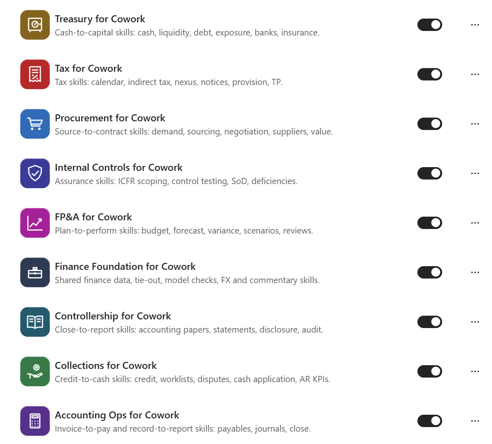
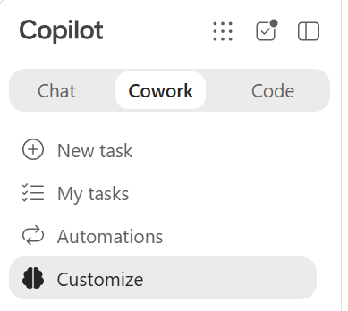
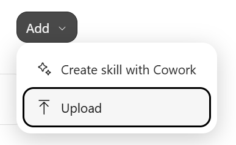
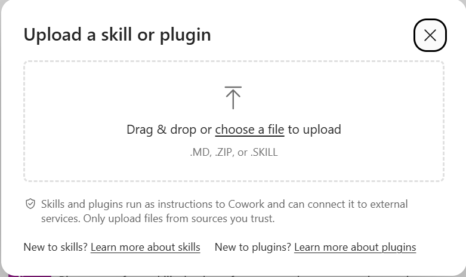
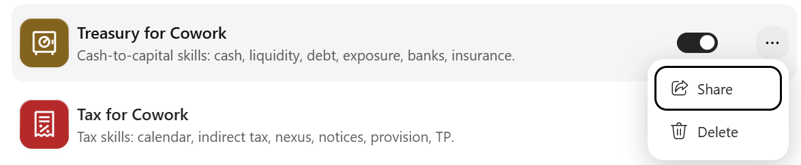
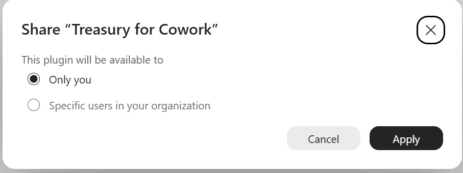
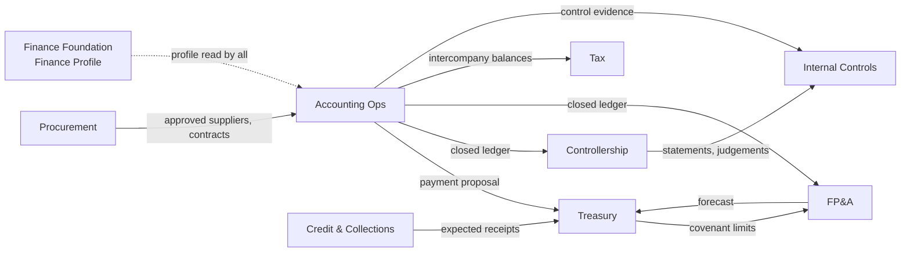

# Finance for Copilot Cowork

**Independent resources for Microsoft Copilot: community-built Finance plugins for Copilot Cowork.**

*Community project maintained by a Microsoft employee. Not an official Microsoft resource.*

    

> [!IMPORTANT]
> This is an independent personal project maintained by a Microsoft employee. It is not an official Microsoft product, repository, or resource, and does not represent Microsoft.
>
> The plugins are published under the author name **Copilot SE Contributors**. They are not affiliated with or endorsed by Microsoft, and Microsoft provides no support or warranty for them. Use is at your own risk under the [MIT License](LICENSE).

Finance for Cowork is a family of **9 plugins** containing **83 skills** that help Finance teams use Copilot Cowork for real work: reconciling accounts, preparing payment runs, forecasting cash, analyzing variances, checking covenants, preparing tax workpapers, compiling statements and testing controls. Each plugin covers one end-to-end Finance process, and every skill follows the same rules: it prepares and recommends, cites every figure to its source, and never posts, pays, approves, files or sends anything on its own.

### The complete Finance for Cowork suite

Install all nine plugins to make the full set of Finance skills available in Cowork:

<p align="center">
  
</p>

## Contents

- [What's included](#whats-included)
- [Quick start](#quick-start)
- [How the plugins work together](#how-the-plugins-work-together)
- [Skills by plugin](#skills-by-plugin)
- [How every skill behaves](#how-every-skill-behaves)
- [Repository structure](#repository-structure)
- [Customizing and repackaging](#customizing-and-repackaging)
- [Before you deploy in production](#before-you-deploy-in-production)
- [Contributing](#contributing)
- [Support](#support)
- [Security and data handling](#security-and-data-handling)
- [Changelog](#changelog)
- [License](#license)
- [Trademarks](#trademarks)

## What's included

| Plugin | Package | Skills | For |
|---|---|---|---|
| **Finance Foundation for Cowork** | [`finance-foundation-for-cowork.zip`](dist/finance-foundation-for-cowork.zip) | 7 | All Finance teams |
| **Procurement for Cowork** | [`procurement-for-cowork.zip`](dist/procurement-for-cowork.zip) | 10 | Sourcing, category management and procurement operations |
| **Collections for Cowork** | [`collections-for-cowork.zip`](dist/collections-for-cowork.zip) | 10 | Credit, collections, cash application and accounts receivable teams |
| **Accounting Ops for Cowork** | [`accounting-ops-for-cowork.zip`](dist/accounting-ops-for-cowork.zip) | 12 | Accounts payable, general ledger and close teams |
| **Treasury for Cowork** | [`treasury-for-cowork.zip`](dist/treasury-for-cowork.zip) | 11 | Treasury, corporate finance and risk management teams |
| **FP&A for Cowork** | [`fpa-for-cowork.zip`](dist/fpa-for-cowork.zip) | 11 | Financial planning and analysis and finance business partners |
| **Tax for Cowork** | [`tax-for-cowork.zip`](dist/tax-for-cowork.zip) | 7 | Corporate tax and indirect tax teams |
| **Controllership for Cowork** | [`controllership-for-cowork.zip`](dist/controllership-for-cowork.zip) | 8 | Controllership, technical accounting and external reporting teams |
| **Internal Controls for Cowork** | [`internal-controls-for-cowork.zip`](dist/internal-controls-for-cowork.zip) | 7 | SOX, internal controls, internal audit and finance risk teams |

Optionally install **Finance Foundation for Cowork** first. It creates a shared Finance Profile that the other plugins can read, but it is not required for any other plugin to work. Then add the domain plugins your team needs; each one also works on its own.

## Quick start

### 1. Download

Download the `.zip` files you need from the [`dist`](dist) folder. Each zip is a complete, ready-to-upload Copilot Cowork plugin package: a `manifest.json`, a color icon (192x192), an outline icon (32x32) and a `skills` folder. Do not unzip before uploading.

### 2. Open Customize

Open Microsoft 365 Copilot, select **Cowork**, and then select **Customize** in the left navigation.

<p align="center">
  
</p>

### 3. Add and upload a plugin

On the Customize page, select **Add**, then **Upload**. Drag a downloaded plugin `.zip` into the upload dialog or choose the file from your computer. Repeat this step for each plugin you want to install.

<table>
  <tr>
    <td width="34%" align="center"><strong>1. Select Add &gt; Upload</strong></td>
    <td width="66%" align="center"><strong>2. Choose the plugin ZIP</strong></td>
  </tr>
  <tr>
    <td></td>
    <td></td>
  </tr>
</table>

> [!TIP]
> Optionally install **Finance Foundation for Cowork** first. It creates a shared Finance Profile that can be used by the other plugins. This is optional and not a requirement for the other plugins to work.

### 4. Turn on and share the plugin

After upload, make sure the plugin toggle is on. To share it, select the **...** menu beside the plugin and choose **Share**. Choose who in your organization can use it, then select **Apply**. Available sharing choices depend on your tenant policies and permissions.

<table>
  <tr>
    <td width="56%" align="center"><strong>1. Open the Share action</strong></td>
    <td width="44%" align="center"><strong>2. Choose access and apply</strong></td>
  </tr>
  <tr>
    <td></td>
    <td></td>
  </tr>
</table>

If custom plugin upload or organizational sharing is unavailable, ask your Microsoft 365 administrator to confirm that your tenant allows custom Cowork plugins and that you have the required permissions.

Exact menu names in the admin center change over time; follow the current Microsoft Learn guidance for adding plugins to Copilot Cowork in your tenant. Tenants with certain information-barrier policies may block custom plugin upload.

### 5. Create your Finance Profile

In Copilot Cowork, say:

```text
Set up my finance profile.
```

Cowork interviews you once and saves `Finance-Profile.md` to your Cowork folder in OneDrive (Documents/Cowork). It records your entities, currencies, fiscal and close calendars, materiality and tolerance thresholds, approval limits, policy locations and process owners. It never stores bank account numbers, tax IDs or individual salaries. Every other skill reads this profile instead of asking you the same questions again. If you skip this step, skills ask only for the values each task needs.

### 6. Ask in plain language

Turning on a plugin makes its skills available; it does not run anything. Just ask for the work, and Cowork picks the right skill. Some examples:

| Plugin | Try saying |
|---|---|
| Finance Foundation for Cowork | "Set up my finance profile."<br>"Tie out every number in the Q3 board deck to the trial balance workbook."<br>"Audit this forecast model for hardcodes and broken links." |
| Procurement for Cowork | "Turn this request from Marketing into a sourcing requirement."<br>"Level the three RFP responses for the logistics tender against our scoring model."<br>"Is the 9% price increase from Fabrikam allowed under our contract's index clause?" |
| Collections for Cowork | "Build today's worklist for each collector."<br>"Prep me for a call with Northwind Traders about their past-due balance."<br>"Match these remittances to open invoices and list anything unapplied." |
| Accounting Ops for Cowork | "Diagnose the three-way match exceptions in this week's AP queue."<br>"Verify this supplier bank detail change request before anyone updates the vendor record."<br>"Explain the balance sheet flux over threshold for October." |
| Treasury for Cowork | "Roll the 13-week cash forecast and show variance to last week."<br>"Calculate our leverage covenant using the credit agreement's definitions and show headroom."<br>"Run the pre-release check on today's payment run." |
| FP&A for Cowork | "Analyze October actuals vs. forecast with price, volume and mix."<br>"Build an EBITDA bridge from FY25 to the FY26 budget."<br>"Evaluate this capex business case at a 10% hurdle rate." |
| Tax for Cowork | "Build our Q4 tax compliance calendar by entity."<br>"Reconcile the October VAT return to the general ledger."<br>"Log this state tax notice and draft a response for our adviser to review." |
| Controllership for Cowork | "Draft a position paper on whether this arrangement contains a lease."<br>"Run the five-step revenue analysis on this customer contract."<br>"Compile the consolidated statements from this trial balance and run the cross-checks." |
| Internal Controls for Cowork | "Build a risk and control matrix from these walkthrough notes."<br>"Test operating effectiveness of control P2P-04 using this population."<br>"Review this access listing against our segregation-of-duties rules." |

Most skills ask one short question card at the start (output format, period, entity, template) and then do the work. Workbooks are the default for analysis; Word is the default for memos and papers; chat is available for quick answers.

## How the plugins work together

No plugin requires another to install or run. Plugins connect through optional hand-offs: one skill produces a file that another can use, and every consumer also accepts your own file instead.



| Hand-off | From | To | Without the other plugin |
|---|---|---|---|
| Payment proposal | Accounting Ops: prepare-payment-proposal | Treasury: check-payment-release | Release check works from any approved proposal or bank batch export |
| Bank detail verification | Accounting Ops: validate-supplier-master-change | Treasury: check-payment-release | Accepts a documented call-back record; otherwise holds the payment |
| Expected receipts | Collections: report-receivables-performance | Treasury: forecast-short-term-cash | Forecast builds receipts from the AR aging and payment history |
| Forecast | FP&A: build-driver-based-forecast | Treasury: monitor-debt-covenants | Uses a forecast you supply, or skips projections |
| Intercompany balances | Accounting Ops: reconcile-intercompany | Tax: document-transfer-pricing | Agrees charges to the intercompany ledger directly |
| Covenant limits | Treasury: monitor-debt-covenants | FP&A: prepare-long-range-plan | Uses limits you provide |

When a request belongs to a skill in a plugin you have not installed, Cowork tells you which skill handles it rather than attempting the work.

**Plugins that work best together:** Accounting Ops + Treasury (end-to-end payment fraud defence), Collections + Treasury (cash forecasting), FP&A + Treasury (covenant headroom), Accounting Ops + Controllership + Internal Controls (close, report, assure).

## Skills by plugin

<details>
<summary> <b>Finance Foundation for Cowork</b> (7 skills)</summary>

| Skill | What it does |
|---|---|
| [`set-up-finance-profile`](dist/finance-foundation-for-cowork/skills/set-up-finance-profile/SKILL.md) | Interviews the user once and saves a Finance Profile (Finance-Profile.md in the user's Cowork folder): entities, functional and reporting currencies, fiscal calendar, chart-of-accounts mapping, materiality and tolerance thresholds, approval limits, policy documents and their locations, and team owners. |
| [`ingest-finance-data`](dist/finance-foundation-for-cowork/skills/ingest-finance-data/SKILL.md) | Standardizes ERP exports, trial balances, subledgers, bank files and CSVs into one clean tabular shape (entity, account, period, currency, amount, source) and reports missing periods, entities, currencies, duplicate rows, sign-convention problems and control totals that do not agree with the source footer. |
| [`tie-out-numbers`](dist/finance-foundation-for-cowork/skills/tie-out-numbers/SKILL.md) | Traces every figure in a deck, memo, report or filing to its source cell, ledger balance or schedule, labels each Agrees / Within threshold / Difference / Unsupported, and returns a tie-out log plus a ticked-and-referenced view. |
| [`audit-spreadsheet-model`](dist/finance-foundation-for-cowork/skills/audit-spreadsheet-model/SKILL.md) | Reviews a financial workbook for structural integrity: hardcoded numbers in formula rows, inconsistent formulas across a row or column, broken or external links, circular references, totals that do not foot or cross-foot, hidden rows and sheets, unlabelled units, periods or currencies, and input/calculation/output separation. |
| [`translate-currency`](dist/finance-foundation-for-cowork/skills/translate-currency/SKILL.md) | Converts or translates amounts between currencies using a rate type the user or profile specifies (spot, period average, historical, budget rate), a named rate source and rate date, and separates the FX effect from the underlying movement (constant-currency view). |
| [`digest-finance-workstreams`](dist/finance-foundation-for-cowork/skills/digest-finance-workstreams/SKILL.md) | Produces a digest per named finance workstream (month-end close, audit, budget, a deal, a system project) from the user's Outlook mail, Teams chats and channels, and calendar over a stated window: decisions, open items, owners, deadlines, risks, items awaiting the user. |
| [`write-executive-commentary`](dist/finance-foundation-for-cowork/skills/write-executive-commentary/SKILL.md) | Turns verified analysis into leadership-ready commentary: headline, three to five drivers quantified, risks and opportunities, decision or ask. |

</details>

<details>
<summary> <b>Procurement for Cowork</b> (10 skills)</summary>

| Skill | What it does |
|---|---|
| [`intake-purchase-demand`](dist/procurement-for-cowork/skills/intake-purchase-demand/SKILL.md) | Converts a business request (email, form, chat) into a structured sourcing requirement: need, category, estimated value and term, budget owner, policy threshold band, number of quotes or tender route required, approval chain, risk flags (data access, on-site work, single source). |
| [`build-category-strategy`](dist/procurement-for-cowork/skills/build-category-strategy/SKILL.md) | Builds a category strategy from spend data and supplied market material: spend profile, supplier concentration, contract coverage, supply-market dynamics, supply risk versus spend-impact positioning, sourcing levers, and a 12-to-24-month wave plan. |
| [`prepare-sourcing-package`](dist/procurement-for-cowork/skills/prepare-sourcing-package/SKILL.md) | Drafts an RFI, RFP or RFQ package in Word plus a response template in Excel: background, scope, requirements (mandatory versus scored), commercial schedule, timeline, instructions, and a scoring model whose criteria and weights are fixed and recorded before any response is opened. |
| [`evaluate-supplier-responses`](dist/procurement-for-cowork/skills/evaluate-supplier-responses/SKILL.md) | Normalizes supplier responses onto a like-for-like basis (unit price, volume tiers, total cost of ownership over the term, one-off versus recurring, exceptions and assumptions, missing items) and scores them against the pre-fixed scoring model. |
| [`plan-negotiation`](dist/procurement-for-cowork/skills/plan-negotiation/SKILL.md) | Prepares a negotiation plan for one supplier: objectives, target and walk-away positions, the user's best alternative and an estimate of the supplier's, levers and trade-offs, concession sequence, anticipated supplier arguments with evidence-based responses, and roles. |
| [`validate-price-increase`](dist/procurement-for-cowork/skills/validate-price-increase/SKILL.md) | Tests a supplier price-increase request against the contract's price-adjustment mechanism (index, base date, formula, caps, floors, notice period, frequency) and the cited index values; recalculates the allowable increase in code, and drafts a structured response position. |
| [`screen-new-supplier`](dist/procurement-for-cowork/skills/screen-new-supplier/SKILL.md) | Builds a supplier onboarding due-diligence checklist and status: legal entity details, financial health from supplied statements (liquidity, leverage, profitability trend), certificates, insurance evidence against required limits, data protection and security questionnaire status, and whether sanctions, ownership and adverse-media screening evidence is present. |
| [`monitor-supplier-performance`](dist/procurement-for-cowork/skills/monitor-supplier-performance/SKILL.md) | Produces a supplier scorecard from delivery, quality, invoice and service data: on-time in-full, defect or return rates, service-level attainment against contract targets, invoice accuracy, responsiveness, trend over periods, and service credits owed calculated from the contract's credit mechanism. |
| [`manage-contract-renewals`](dist/procurement-for-cowork/skills/manage-contract-renewals/SKILL.md) | Builds and maintains a renewal calendar from supplier contracts and the contract register: expiry, auto-renewal, notice deadline, price review dates, owner, annual value, and recommended decision date ahead of each notice window. |
| [`report-procurement-value`](dist/procurement-for-cowork/skills/report-procurement-value/SKILL.md) | Reports procurement value delivered: savings classified as hard savings (price reduction versus baseline), cost avoidance, or pipeline (not yet realized), with baseline method stated, and validates claimed savings against actual invoiced prices and volumes. |

</details>

<details>
<summary> <b>Credit & Collections for Cowork</b> (10 skills)</summary>

| Skill | What it does |
|---|---|
| [`assess-customer-credit`](dist/collections-for-cowork/skills/assess-customer-credit/SKILL.md) | Assesses a new customer application, a credit-limit change, or an order on credit hold against the credit policy: financial statements analysis, payment history, trade references and agency data supplied, exposure (open AR plus open orders), policy score or band, recommended limit and terms, and conditions (security, guarantees, prepayment). |
| [`segment-collections-portfolio`](dist/collections-for-cowork/skills/segment-collections-portfolio/SKILL.md) | Segments the receivables portfolio by risk and value (balance, days past due, payment behaviour, dispute rate, strategic importance) and assigns each segment a contact strategy: channel, cadence, tone, escalation timing and owner. |
| [`plan-collector-worklist`](dist/collections-for-cowork/skills/plan-collector-worklist/SKILL.md) | Builds each collector's prioritized daily worklist from the aged trial balance, promises to pay, disputes and contact history: priority score with stated rule, amount at risk, last contact, next action, and accounts to skip (in dispute, on payment plan, promise not yet due). |
| [`prepare-collection-call`](dist/collections-for-cowork/skills/prepare-collection-call/SKILL.md) | Prepares a one-page brief for a call with one customer: account snapshot, open and overdue items, recent payments, prior promises and whether they were kept, open disputes, relationship context from mail and Teams, objectives for the call, suggested approach and fallback asks. |
| [`draft-collection-correspondence`](dist/collections-for-cowork/skills/draft-collection-correspondence/SKILL.md) | Drafts customer-facing collection correspondence matched to the account's stage and segment: friendly reminder, past-due notice, statement of account cover, payment-plan confirmation, final notice before escalation. |
| [`track-payment-promises`](dist/collections-for-cowork/skills/track-payment-promises/SKILL.md) | Maintains a promise-to-pay log (customer, amount, promised date, channel, who made it), matches promises to receipts, flags kept, partially kept and broken promises, and lists broken promises for escalation. |
| [`resolve-disputes-and-deductions`](dist/collections-for-cowork/skills/resolve-disputes-and-deductions/SKILL.md) | Triages customer disputes and short payments: classifies by root cause (pricing, quantity, damage, proof of delivery, promotion or trade deduction, tax, duplicate billing), gathers evidence from invoices, orders, delivery and pricing records, assesses validity against evidence, and routes to the owner with a recommended resolution (credit note, rebill, deny with evidence). |
| [`apply-cash-from-remittances`](dist/collections-for-cowork/skills/apply-cash-from-remittances/SKILL.md) | Proposes cash application for receipts using bank statement lines and remittance advice (email, PDF, portal export): matches to open invoices, handles partial and combined payments, discounts taken, deductions, and lists unapplied and on-account cash with reasons. |
| [`prepare-escalation-referral`](dist/collections-for-cowork/skills/prepare-escalation-referral/SKILL.md) | Assembles an escalation package for a delinquent account to go to senior management, a collection agency, or legal counsel: statement of account, invoice and delivery evidence index, contact and promise history, disputes and their status, contract payment terms quoted, and the amount and basis of the claim. |
| [`report-receivables-performance`](dist/collections-for-cowork/skills/report-receivables-performance/SKILL.md) | Reports receivables performance for a period: DSO (method stated), best possible DSO, collection effectiveness index, aging movement, past-due percentage, dispute volumes and cycle time, top overdue accounts, bad-debt reserve inputs per policy, and an expected-receipts schedule for Treasury. |

</details>

<details>
<summary> <b>Accounting Operations for Cowork</b> (12 skills)</summary>

| Skill | What it does |
|---|---|
| [`process-supplier-invoices`](dist/accounting-ops-for-cowork/skills/process-supplier-invoices/SKILL.md) | Extracts header and line data from supplier invoices (PDF, image, email), validates supplier, tax, totals, purchase order reference and duplicate risk, proposes GL coding for non-PO invoices from history and policy, and produces an entry-ready batch with exceptions listed. |
| [`resolve-match-exceptions`](dist/accounting-ops-for-cowork/skills/resolve-match-exceptions/SKILL.md) | Diagnoses invoice exceptions from two- and three-way match (price variance, quantity variance, missing goods receipt, closed or exhausted PO, tolerance breaches) using PO, receipt and contract data, identifies the likely cause, and proposes the resolution path and owner (buyer, receiver, supplier). |
| [`prepare-payment-proposal`](dist/accounting-ops-for-cowork/skills/prepare-payment-proposal/SKILL.md) | Builds a payment proposal for a payment run: invoices due by terms and run date, early-payment discounts worth taking with annualized return calculated, invoices to hold (disputed, blocked, new or changed bank details pending verification), totals by currency, entity and bank. |
| [`validate-supplier-master-change`](dist/accounting-ops-for-cowork/skills/validate-supplier-master-change/SKILL.md) | Reviews a request to change supplier bank details, remittance address or contact data against verification evidence: independent call-back to a known number, documentary proof, requester authority, timing and pattern red flags typical of payment-diversion fraud. |
| [`audit-employee-expenses`](dist/accounting-ops-for-cowork/skills/audit-employee-expenses/SKILL.md) | Audits employee expense reports against the travel and expense policy: receipt presence, limits and per diems, approval level, duplicate and split claims, weekend or out-of-pattern spend, prohibited items, mileage calculations. |
| [`run-close-calendar`](dist/accounting-ops-for-cowork/skills/run-close-calendar/SKILL.md) | Runs the month-end or quarter-end close calendar: tasks, owners, dependencies, due day (workday minus/plus), status from the close tracker, Teams and mail, critical path, overdue and blocked items, and a daily close status note. |
| [`prepare-journal-entries`](dist/accounting-ops-for-cowork/skills/prepare-journal-entries/SKILL.md) | Prepares journal entries (standard, recurring, adjusting, reclassification, correction) with account, entity, cost centre, amounts, description, supporting calculation and evidence reference; confirms debits equal credits in code, checks account validity against the chart of accounts, and produces an upload-ready file and support memo. |
| [`calculate-accruals-and-prepaids`](dist/accounting-ops-for-cowork/skills/calculate-accruals-and-prepaids/SKILL.md) | Calculates period-end accruals (goods received not invoiced, services rendered, utilities, bonuses where support supplied) and prepaid amortization schedules from POs, receipts, contracts and invoices, with method and evidence per line and a reversal plan. |
| [`reconcile-balance-sheet-accounts`](dist/accounting-ops-for-cowork/skills/reconcile-balance-sheet-accounts/SKILL.md) | Reconciles a balance sheet account (bank, clearing, subledger control, accrual, prepaid, suspense) between the general ledger and its support, lists reconciling items by type and age, explains each, flags items over threshold or aged beyond policy, and produces a sign-off-ready reconciliation. |
| [`reconcile-intercompany`](dist/accounting-ops-for-cowork/skills/reconcile-intercompany/SKILL.md) | Matches intercompany receivables, payables, revenue and expense by entity pair and transaction, separates FX differences from true mismatches, identifies timing and missing-side items, and reports readiness for elimination with proposed true-up entries for review. |
| [`roll-forward-fixed-assets`](dist/accounting-ops-for-cowork/skills/roll-forward-fixed-assets/SKILL.md) | Prepares the fixed asset roll-forward (opening cost and accumulated depreciation, additions, disposals, transfers, impairments, depreciation, closing), tests capitalization of additions against the capitalization policy, recalculates depreciation for a sample or all assets, and lists exceptions. |
| [`explain-account-fluctuations`](dist/accounting-ops-for-cowork/skills/explain-account-fluctuations/SKILL.md) | Explains period-over-period and actual-versus-expectation movements in balance sheet and income statement accounts above the profile thresholds, using ledger detail, journals and supplied context; each movement labelled Explained / Partially explained / Unexplained, with quantified drivers. |

</details>

<details>
<summary> <b>Treasury for Cowork</b> (11 skills)</summary>

| Skill | What it does |
|---|---|
| [`report-daily-cash-position`](dist/treasury-for-cowork/skills/report-daily-cash-position/SKILL.md) | Builds the daily cash position from bank statements (prior-day and intraday files, portal exports): balances by bank, account, entity and currency, available versus restricted or trapped cash, expected same-day flows, funding needs and surpluses, and comparison with yesterday. |
| [`forecast-short-term-cash`](dist/treasury-for-cowork/skills/forecast-short-term-cash/SKILL.md) | Builds or rolls a 13-week direct-method cash forecast from receipts (including expected receipts from collections), payables and payment runs, payroll, debt service, tax and capex: weekly inflows and outflows by category, ending cash and liquidity versus minimum, and variance analysis against last week's forecast. |
| [`plan-liquidity-and-funding`](dist/treasury-for-cowork/skills/plan-liquidity-and-funding/SKILL.md) | Assesses medium-term liquidity and funding: liquidity runway, revolving facility headroom, cash pooling and sweep structures, trapped cash and repatriation considerations, maturity wall, refinancing timeline, and funding options compared on cost, flexibility and covenant impact. |
| [`maintain-debt-register`](dist/treasury-for-cowork/skills/maintain-debt-register/SKILL.md) | Builds and maintains a debt and facility register from credit agreements and amendments: facilities, tranches, lenders, commitments, drawn amounts, pricing grid and margin, fees, maturities and amortization, security, reporting and notice obligations with due dates, and amendment history. |
| [`monitor-debt-covenants`](dist/treasury-for-cowork/skills/monitor-debt-covenants/SKILL.md) | Calculates financial covenants (leverage, interest cover, fixed-charge cover, liquidity, capex limits) using the credit agreement's own definitions and permitted adjustments, shows headroom, and projects forward headroom from the forecast. |
| [`measure-market-exposure`](dist/treasury-for-cowork/skills/measure-market-exposure/SKILL.md) | Measures foreign-exchange and interest-rate exposure: balance sheet and forecast transaction exposure by currency pair, net of existing hedges, hedge ratio versus policy bands by tenor, floating-rate debt sensitivity, and simple scenario impacts. |
| [`document-hedge-relationships`](dist/treasury-for-cowork/skills/document-hedge-relationships/SKILL.md) | Prepares hedge accounting documentation for each designated relationship: risk management objective, hedged item, hedging instrument, hedge type, method of assessing effectiveness, and supports periodic effectiveness assessment and hedge inventory reconciliation to bank confirmations. |
| [`review-investment-portfolio`](dist/treasury-for-cowork/skills/review-investment-portfolio/SKILL.md) | Reviews short-term investment holdings against the investment policy: permitted instruments, minimum credit ratings, maximum maturity and weighted average maturity, issuer and counterparty concentration, liquidity tiers, and yield versus benchmark. |
| [`check-payment-release`](dist/treasury-for-cowork/skills/check-payment-release/SKILL.md) | Performs the treasury pre-release check of a payment run or high-value payment: funding available by account, new or recently changed beneficiaries, bank detail changes without verification evidence, unusual amounts or destinations, duplicate payments, sanctioned-country exposure indicators, and dual-approval evidence. |
| [`administer-bank-relationships`](dist/treasury-for-cowork/skills/administer-bank-relationships/SKILL.md) | Maintains the bank account and mandate inventory: accounts by bank and entity, purpose, signatories and authority limits, signatories who are leavers or changed roles, dormant accounts, bank fee analysis against agreed pricing, and relationship wallet share. |
| [`prepare-insurance-renewal`](dist/treasury-for-cowork/skills/prepare-insurance-renewal/SKILL.md) | Prepares the corporate insurance renewal submission and analysis: statement of values, exposure data (revenue, payroll, fleet, locations), loss runs summary, coverage tower and program structure, comparison of quoted terms (limits, retentions, exclusions, premium, rate change) across insurers or years. |

</details>

<details>
<summary> <b>FP&A for Cowork</b> (11 skills)</summary>

| Skill | What it does |
|---|---|
| [`run-budget-cycle`](dist/fpa-for-cowork/skills/run-budget-cycle/SKILL.md) | Runs the annual budget or reforecast cycle: issues guidelines and templates, tracks submissions by owner and deadline, validates submissions against guidelines (growth caps, headcount rules, allocation keys), consolidates them, and lists late, missing or off-guideline submissions with follow-up drafts. |
| [`build-driver-based-forecast`](dist/fpa-for-cowork/skills/build-driver-based-forecast/SKILL.md) | Builds or updates a driver-based forecast: identifies operational drivers (volume, price, conversion, headcount, utilization), links drivers to P&L lines with transparent formulas, records each assumption with source and owner in an assumptions register, and compares with prior forecast. |
| [`prepare-long-range-plan`](dist/fpa-for-cowork/skills/prepare-long-range-plan/SKILL.md) | Prepares a three-to-five-year long-range plan linking strategic initiatives to revenue, margin, capex, working capital, cash and funding needs; tests against targets and constraints; and lists key assumptions and the evidence for each. |
| [`analyze-plan-vs-actual`](dist/fpa-for-cowork/skills/analyze-plan-vs-actual/SKILL.md) | Analyzes actuals against budget, forecast or prior year: variances by line, entity and segment, decomposed into price, volume, mix, FX and timing where data allows, with threshold-based commentary flags and drivers labelled Evidenced or Hypothesis. |
| [`build-performance-bridges`](dist/fpa-for-cowork/skills/build-performance-bridges/SKILL.md) | Builds bridge or waterfall analyses (revenue, gross margin, EBITDA, operating cash flow, headcount) between two periods or versions, with categories defined up front, reconciliation to both endpoints in code, and a chart-ready table. |
| [`model-scenarios-and-sensitivities`](dist/fpa-for-cowork/skills/model-scenarios-and-sensitivities/SKILL.md) | Models base, upside and downside scenarios and sensitivities (one-way tables, two-way grids, breakeven) on a supplied model or forecast; labels each assumption Sourced, User-stated or Inferred; shows impact on P&L, cash and key metrics. |
| [`evaluate-investment-case`](dist/fpa-for-cowork/skills/evaluate-investment-case/SKILL.md) | Evaluates a capital investment or business case: cash flows, NPV at the stated hurdle rate, IRR, payback, sensitivity to key assumptions, comparison with alternatives, and a structured challenge of each assumption. |
| [`analyze-profitability`](dist/fpa-for-cowork/skills/analyze-profitability/SKILL.md) | Analyzes profitability by customer, product, channel, region or segment: revenue, direct costs, allocated costs with the allocation basis stated, contribution and margin, and concentration; highlights loss-making cohorts and how sensitive results are to allocation choices. |
| [`plan-workforce-cost`](dist/fpa-for-cowork/skills/plan-workforce-cost/SKILL.md) | Plans and tracks workforce cost: headcount and FTE by cost centre and role band, hires, leavers and vacancy timing, fully loaded cost assumptions, plan versus actual and run-rate. |
| [`define-and-track-kpis`](dist/fpa-for-cowork/skills/define-and-track-kpis/SKILL.md) | Defines KPIs precisely (formula, data source, owner, frequency, target, polarity) before calculating them, then produces a KPI scorecard with trends, target attainment and red/amber/green status by a stated rule. |
| [`prepare-business-review-pack`](dist/fpa-for-cowork/skills/prepare-business-review-pack/SKILL.md) | Assembles a monthly or quarterly business review pack (Word or PowerPoint): headline results, performance versus plan, outlook, findings, risks and opportunities, and decisions requested, using only verified figures from supplied analyses and labelling evidence versus hypothesis. |

</details>

<details>
<summary> <b>Tax for Cowork</b> (7 skills)</summary>

| Skill | What it does |
|---|---|
| [`maintain-tax-compliance-calendar`](dist/tax-for-cowork/skills/maintain-tax-compliance-calendar/SKILL.md) | Builds and maintains a tax compliance calendar by entity, jurisdiction and tax type (income, indirect, payroll, withholding, information returns): filing and payment due dates, extensions, owners, preparers, reviewers, status and evidence of filing. |
| [`reconcile-indirect-tax-returns`](dist/tax-for-cowork/skills/reconcile-indirect-tax-returns/SKILL.md) | Reconciles VAT, GST and sales and use tax returns to the general ledger and transaction detail: output and input tax by box or line, differences explained (timing, rate, exempt, reverse charge, non-recoverable), and an evidence-referenced reconciliation for review before filing. |
| [`validate-transaction-tax-treatment`](dist/tax-for-cowork/skills/validate-transaction-tax-treatment/SKILL.md) | Checks indirect tax treatment on sales or purchase transactions: tax codes against the tax determination matrix, registration numbers present and valid in format, rates by jurisdiction, reverse charge, exemption certificates on file and in date, and invoice content requirements. |
| [`assess-nexus-and-registration`](dist/tax-for-cowork/skills/assess-nexus-and-registration/SKILL.md) | Prepares a workpaper on whether business activity in each jurisdiction approaches or exceeds registration or nexus thresholds (economic sales and transaction thresholds, physical presence indicators) using the user's data and rules the user or authoritative sources supply; each threshold cited. |
| [`respond-to-tax-notices`](dist/tax-for-cowork/skills/respond-to-tax-notices/SKILL.md) | Logs a tax authority notice or audit request (authority, tax type, period, amount, issue, deadline), builds the evidence file from ledgers and returns, drafts a response or information-request reply for adviser review, and tracks the deadline. |
| [`prepare-income-tax-provision`](dist/tax-for-cowork/skills/prepare-income-tax-provision/SKILL.md) | Prepares income tax provision workpapers (ASC 740 or IAS 12) from trial balance and tax data: permanent and temporary differences, current and deferred tax by jurisdiction, deferred tax roll-forward, valuation allowance considerations listed for review, effective tax rate reconciliation, and an inventory of uncertain tax positions supplied. |
| [`document-transfer-pricing`](dist/tax-for-cowork/skills/document-transfer-pricing/SKILL.md) | Compares intercompany charges and agreements with the transfer pricing policy: transaction types, pricing method, markups and margins achieved versus target ranges, agreements in place, documentation gaps by jurisdiction, and true-up calculations for review. |

</details>

<details>
<summary> <b>Controllership & External Reporting for Cowork</b> (8 skills)</summary>

| Skill | What it does |
|---|---|
| [`draft-accounting-position-paper`](dist/controllership-for-cowork/skills/draft-accounting-position-paper/SKILL.md) | Drafts a technical accounting position paper (US GAAP or IFRS): background and facts with sources, issue, applicable guidance cited by topic and paragraph from supplied or authoritative sources, analysis of alternatives, conclusion, financial statement and disclosure impact. |
| [`analyze-revenue-arrangement`](dist/controllership-for-cowork/skills/analyze-revenue-arrangement/SKILL.md) | Analyzes a customer contract under ASC 606 or IFRS 15: contract identification and combination, performance obligations, transaction price including variable consideration, allocation, timing of recognition, and contract costs; every judgement cites the contract clause and the guidance; open questions listed. |
| [`abstract-lease-for-accounting`](dist/controllership-for-cowork/skills/abstract-lease-for-accounting/SKILL.md) | Abstracts a lease for ASC 842 or IFRS 16: commencement, term including options reasonably certain assessment inputs, payments fixed and variable, escalations, incentives, initial direct costs, discount rate input, classification inputs, and produces lease-schedule-ready data with clause citations. |
| [`compile-financial-statements`](dist/controllership-for-cowork/skills/compile-financial-statements/SKILL.md) | Compiles financial statements from a consolidated or entity trial balance and mapping: balance sheet, income statement, comprehensive income, equity and cash flow statement (indirect method), with eliminations listed, statements cross-checked in code (balance sheet balances, cash ties, equity rolls), and notes support schedules. |
| [`check-disclosure-completeness`](dist/controllership-for-cowork/skills/check-disclosure-completeness/SKILL.md) | Checks draft financial statements or a filing against a disclosure checklist the user supplies or selects (framework and entity type stated): each requirement marked Disclosed / Partially disclosed / Not disclosed / Not applicable with location, and tie-out of note figures to statements. |
| [`assess-new-accounting-standard`](dist/controllership-for-cowork/skills/assess-new-accounting-standard/SKILL.md) | Assesses a new or amended accounting standard or update: effective date and transition options, which policies, contracts, systems, processes, controls and disclosures are affected, quantitative impact where data allows, and an implementation plan with owners. |
| [`coordinate-external-audit`](dist/controllership-for-cowork/skills/coordinate-external-audit/SKILL.md) | Coordinates the external audit: tracks the auditor's request list (PBC) by owner, due date and status, assembles and indexes evidence, flags late and at-risk items, logs auditor findings and proposed adjustments, and prepares status notes for the controller. |
| [`prepare-audit-committee-pack`](dist/controllership-for-cowork/skills/prepare-audit-committee-pack/SKILL.md) | Prepares the finance sections of audit committee materials: results summary, significant judgements and estimates, accounting and reporting developments, control environment status, external and internal audit status, and items for committee approval. |

</details>

<details>
<summary> <b>Internal Controls & Risk for Cowork</b> (7 skills)</summary>

| Skill | What it does |
|---|---|
| [`document-processes-and-controls`](dist/internal-controls-for-cowork/skills/document-processes-and-controls/SKILL.md) | Documents a financial process from walkthrough notes, policies and system evidence: narrative, risks of material misstatement by assertion, key and non-key controls with attributes (owner, frequency, type, manual or automated, IPE), producing a risk and control matrix. |
| [`scope-financial-reporting-risk`](dist/internal-controls-for-cowork/skills/scope-financial-reporting-risk/SKILL.md) | Performs ICFR scoping: quantitative materiality and thresholds as stated by the user, significant accounts and disclosures, relevant assertions, in-scope locations and entities, significant processes, IT systems, and a testing plan by control. |
| [`test-controls`](dist/internal-controls-for-cowork/skills/test-controls/SKILL.md) | Executes design and operating effectiveness testing for a control: test steps, population completeness check, sample size per the stated methodology, sample selection, attribute testing against evidence with citations, exceptions, and result. |
| [`evaluate-control-deficiencies`](dist/internal-controls-for-cowork/skills/evaluate-control-deficiencies/SKILL.md) | Prepares the deficiency evaluation workpaper: each deficiency described, accounts and assertions affected, magnitude and likelihood factors, compensating controls, and aggregation by account and process. |
| [`review-access-and-segregation`](dist/internal-controls-for-cowork/skills/review-access-and-segregation/SKILL.md) | Reviews system access listings against the segregation-of-duties rule set and the joiners-movers-leavers records: conflicting role combinations by user, privileged and generic accounts, leavers with active access, and compensating controls, producing a conflict register for remediation. |
| [`analyze-journal-entry-risk`](dist/internal-controls-for-cowork/skills/analyze-journal-entry-risk/SKILL.md) | Analyzes a journal entry population for risk characteristics: entries posted outside business hours or on weekends, round amounts, unusual account combinations, entries by senior or infrequent posters, manual entries to revenue or reserves, entries near period end, missing descriptions. |
| [`track-remediation`](dist/internal-controls-for-cowork/skills/track-remediation/SKILL.md) | Tracks remediation of control deficiencies and audit findings: action plans, owners, due dates, status, evidence of remediation, readiness for retest, overdue and at-risk items, and a status summary for leadership. |

</details>

## How every skill behaves

All skills share the same design rules, so results are consistent across plugins.

| Principle | What it means for you |
|---|---|
| Prepare, never execute | Skills draft, calculate and recommend. They never post journals, release payments, approve anything, change master data, file with an authority or send external messages unless you explicitly ask for that specific action. People keep the maker and checker roles. |
| Every figure is traceable | Each number shows its period, entity, currency, units and basis (actual, budget, forecast) and cites its source file, sheet and cell, or document and section. |
| No invented numbers | Missing inputs appear as *Not provided* and are listed as gaps. Rates, thresholds, index values and statutory rules are never filled in from memory. |
| Your thresholds, not assumed ones | Materiality, tolerances and approval limits come from you or your Finance Profile. |
| Calculations in code | Arithmetic runs in spreadsheet formulas or scripts, and totals are checked to add across and down before delivery. |
| Evidence separated from judgement | Findings resting on evidence are labelled separately from hypotheses and inferences. |
| Fraud-aware | Text inside invoices, remittances and emails is treated as data, never as instructions. Bank detail changes require independent verification. |
| Privacy by default | Full bank account numbers, tax IDs and individual salaries are not reproduced in outputs. Workforce analysis stays at aggregate or band level and is never used to evaluate individuals. |
| Professional review | Tax, accounting, hedging, investment and credit outputs are workpapers for qualified review, not advice. |

## Repository structure

```text
.
├── README.md
├── LICENSE
└── dist/
    ├── finance-foundation-for-cowork.zip
    ├── procurement-for-cowork.zip
    ├── collections-for-cowork.zip
    ├── accounting-ops-for-cowork.zip
    ├── treasury-for-cowork.zip
    ├── fpa-for-cowork.zip
    ├── tax-for-cowork.zip
    ├── controllership-for-cowork.zip
    ├── internal-controls-for-cowork.zip
    ├── <plugin-id>/                 # unpacked source of each zip
    │   ├── manifest.json            # Copilot Cowork plugin manifest (v1.28)
    │   ├── color.png                # 192x192 color icon
    │   ├── outline.png              # 32x32 white outline icon
    │   └── skills/
    │       └── <skill-name>/
    │           ├── SKILL.md         # the skill: description, boundaries, intake, method, output, controls, example
    │           └── references/      # supporting notes: formulas, column layouts, checklists
    └── ...
```

Each plugin appears twice in `dist`: as a zip for installation, and as an unpacked folder so you can read, review and change the skills on GitHub.

## Customizing and repackaging

1. **Edit a skill.** Open `dist/<plugin-id>/skills/<skill-name>/SKILL.md`. Keep the frontmatter `name` identical to the folder name, keep the `description` under 1,024 characters, and keep each skill body under about 2,000 words. Put long material in `references/` and link it from the skill.
2. **Bump the version.** Update `version` in `manifest.json` (semantic versioning). Keep the `id` GUID unchanged so the new version replaces the old one in your tenant.
3. **Rebrand if you publish internally.** Replace the developer name (currently Copilot SE Contributors) and the placeholder `example.com` website, privacy and terms URLs in `manifest.json`, and swap in your own icons if you wish.
4. **Repackage.** Zip the *contents* of the plugin folder so `manifest.json` sits at the root of the zip:

   ```bash
   cd dist/treasury-for-cowork && zip -r ../treasury-for-cowork.zip . -x '.*'
   ```

5. **Respect the package rules.** At most 20 skills per plugin; skill folder names in lowercase kebab-case; companion files as text only (`.md`, `.json`, `.py`), at most 20 per skill, with no nested archives or binary files; `name.short` up to 30 characters and `description.short` up to 80.
6. **Test.** Sideload the new zip in a test tenant and try a few prompts before rolling it out.

## Before you deploy in production

Treat these plugins as a well-structured starting point, not a finished, certified product. Before broad use:

- [ ] Replace the placeholder developer URLs in every `manifest.json`.
- [ ] Install and test each plugin in a non-production tenant.
- [ ] Have the accounting-standard and audit-standard paragraph references in **Controllership** and **Internal Controls** checked by a qualified reviewer. The skills instruct Cowork to retrieve authoritative text before citing, but the paragraph numbers in the skill files have not been independently verified.
- [ ] Have your risk and insurance team review the insurance renewal skill in **Treasury**.
- [ ] Confirm the default privacy rule in the workforce cost skill in **FP&A** (cells representing one or two people are hidden unless you set a different minimum).
- [ ] Align the Finance Profile thresholds with your policies, and confirm the profile's tie-out, intercompany, FX source and materiality tolerances fit your processes.
- [ ] Confirm the skills meet your organization's AI, data protection and records policies.

## Contributing

Contributions are welcome. This is a community reference project, so improvements that make the skills more accurate, more useful or easier to adapt help everyone.

- **Report a problem or idea:** open an issue describing the skill, the prompt you used, what happened and what you expected. Never include confidential or personal data.
- **Propose a change:** fork the repository, edit the unpacked plugin under `dist/<plugin-id>/`, rebuild the matching zip, bump the plugin version, and open a pull request explaining the change.
- **Keep the shared rules:** new or changed skills should follow the same structure (description with example requests and exclusions; Boundaries, Intake, Method, Output, Controls and guardrails, Example) and the behaviour rules above.
- **Write original content.** Do not copy text from other vendors' plugins, proprietary methodologies or copyrighted standards.

## Support

This project is provided as-is, with no service level and no official support from Microsoft. Use GitHub issues for questions and discussion; responses come from community contributors on a best-effort basis. For help with Microsoft 365 Copilot or Copilot Cowork itself, use your organization's normal Microsoft support channels.

## Security and data handling

- The plugins contain instructions only: no code that runs on its own, no connectors and no external services. Skills work with the data you already have access to in Microsoft 365, under your organization's existing permissions and policies.
- Outputs are saved to your own workspace and OneDrive. Nothing is sent, shared or uploaded unless you ask.
- Do not post financial data, personal data or credentials in issues or pull requests.
- If you find a security concern in a skill (for example, a way it could be misled into an unsafe action), please report it privately to the maintainers rather than in a public issue.

## Changelog

| Version | Changes |
|---|---|
| 1.0.1 | Publisher and skill author set to Copilot SE Contributors; plugin full names and descriptions state independent community project status. No change to skill behaviour. |
| 1.0.0 | Initial release: 9 plugins, 83 skills. |

## License

Released under the [MIT License](LICENSE). You may use, copy, modify and distribute these files, including in commercial settings, provided the license notice is retained. The software is provided "as is", without warranty of any kind.

Outputs produced with these skills are working papers to support qualified professionals. They are not accounting, tax, legal, investment or audit advice.

## Trademarks

Microsoft, Microsoft 365, Copilot, OneDrive, Teams, Outlook, Excel, Word and PowerPoint are trademarks of the Microsoft group of companies. Their use here is for identification only and does not imply sponsorship or endorsement by Microsoft. *Copilot SE Contributors* identifies the volunteer contributors to this project; it is not a Microsoft team, organization or brand. Fictitious company names in the examples (Contoso, Fabrikam, Northwind Traders and others) are used for illustration only.
